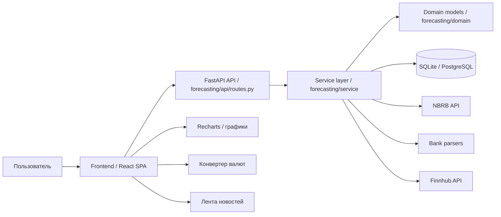

# Currency Forecasting App

## 1. Название, назначение, целевые пользователи

Currency Forecasting App — веб-приложение для мониторинга и прогнозирования курсов валют. Проект собирает официальные курсы НБРБ, отображает динамику изменения валют по периодам, рассчитывает краткосрочные прогнозы и показывает технические индикаторы (SMA/EMA, уровни поддержки и сопротивления).

Основная задача приложения — дать пользователю быстрый и удобный доступ к данным по валютным курсам и прогнозной аналитике для принятия решений о покупке, продаже или сравнении курсов.

Целевые пользователи:
- частные лица, совершающие операции с валютой;
- туристы и путешественники;
- сотрудники компаний, работающих с зарубежными контрактами;
- аналитики и студенты, изучающие финансовые рынки;
- пользователи, интересующиеся прогнозированием курсов на основе статистических моделей.

## 2. Стек технологий

- Язык программирования: Python, TypeScript
- Backend: FastAPI, Uvicorn
- Frontend: React + Vite + TypeScript
- UI и визуализация: Recharts, CSS
- Аналитика: pandas, numpy, statsmodels (SARIMAX)
- СУБД: SQLite по умолчанию, PostgreSQL в Docker/инфраструктурном окружении
- Внешние источники данных: API НБРБ, Finnhub, парсинг данных банковских ресурсов
- Тестирование: pytest, Vitest
- Контейнеризация: Docker Compose

## 3. Архитектура системы



### Основные компоненты системы
- Frontend — пользовательский интерфейс, маршрутизация, графики, страницы валютной пары, конвертер и новости.
- API — слой HTTP-запросов на FastAPI, обеспечивающий взаимодействие между клиентом и логикой приложения.
- Service layer — бизнес-логика: синхронизация курсов, расчёт прогнозов, технических индикаторов, метрик и конвертация валют.
- Domain — доменные сущности, модели и контракты репозитория.
- Infrastructure — адаптеры к внешним сервисам, базе данных и источникам котировок.
- Database — SQLite или PostgreSQL для хранения актуальных и исторических курсов.

## 4. Перечень модулей с кратким описанием ответственности

### Backend (`forecasting`)
- `forecasting/api/routes.py` — HTTP-роуты, входные параметры, обработка запросов и ответов.
- `forecasting/service/rate_service.py` — основная бизнес-логика: синхронизация данных, конвертация, прогнозы и построение дашборда.
- `forecasting/service/forecaster.py` — реализация модели прогнозирования, в том числе SARIMAX.
- `forecasting/service/technical.py` — вычисление SMA, EMA, уровней поддержки и сопротивления.
- `forecasting/service/metrics_calc.py` — расчёт MAPE и RMSE для оценки качества прогноза.
- `forecasting/service/pairs.py` — поддерживаемые валютные пары и логика их обработки.
- `forecasting/domain/models.py` — доменные модели данных.
- `forecasting/domain/repositories.py` — абстракция репозитория.
- `forecasting/infrastructure/nbrb_client.py` — клиент для API Национального банка Республики Беларусь.
- `forecasting/infrastructure/sqlite_repository.py` — реализация хранилища в SQLite.
- `forecasting/infrastructure/db_repository.py` — реализация хранилища в PostgreSQL.
- `forecasting/infrastructure/finnhub_client.py` — интеграция с сервисом финансовых новостей.
- `forecasting/infrastructure/belarusbank_client.py` — сбор данных с банковских источников.
- `forecasting/infrastructure/myfin_client.py` — дополнительный источник курсов и аналитики.

### Frontend (`frontend/src`)
- `frontend/src/App.tsx` — маршрутизация приложения.
- `frontend/src/pages/` — страницы интерфейса: главная страница, страница валютной пары, конвертер, новости.
- `frontend/src/components/` — компоненты интерфейса и переиспользуемые блоки.
- `frontend/src/api/` — клиент HTTP для общения с backend.
- `frontend/src/utils/` — вспомогательные функции, форматирование валютных значений.
- `frontend/src/types/` — TypeScript-модели данных для клиентской части.

## 5. Точки интеграции

- База данных:
  - SQLite по умолчанию;
  - PostgreSQL при использовании Docker/инфраструктурного окружения.
- Внешние сервисы:
  - API НБРБ — официальные курсы валют и исторические данные;
  - Finnhub — финансовые новости;
  - банковские источники — дополнительные проверки курсов.
- Файловая система:
  - локальные конфигурационные файлы;
  - логи;
  - данные кэша и временных файлов.
- Контейнеризация:
  - Docker Compose используется для запуска инфраструктурного окружения.
- Кэширование:
  - временное хранение данных для уменьшения нагрузки на внешние API и ускорения отклика.

## 6. Инструкция по сборке и запуску

### Требования
- Python 3.10+
- Node.js 18+
- npm
- Docker (при необходимости)

### 1. Клонирование репозитория
```bash
git clone https://github.com/angkhls/coursework-Currency-Forecasting-App.git
cd coursework-Currency-Forecasting-App
```

### 2. Backend
```bash
cd forecasting
python3 -m venv venv
source venv/bin/activate
pip install -r requirements.txt
cp .env.example .env
python -m uvicorn main:app --reload --host 0.0.0.0 --port 8000
```

После запуска API будет доступно:
- http://localhost:8000
- Swagger UI: http://localhost:8000/docs

### 3. Frontend
```bash
cd frontend
npm install
npm run dev
```

После запуска приложение будет доступно по адресу:
- http://localhost:3000

### 4. Docker / инфраструктура
```bash
cd infra
docker compose up -d
```

### 5. Тестирование

#### Backend
```bash
cd forecasting
source venv/bin/activate
pip install -r requirements-dev.txt
pytest
```

#### Frontend
```bash
cd frontend
npm test
```

## 7. Текущее состояние проекта

Проект находится в рабочем состоянии и включает следующие основные сценарии:
- просмотр актуальных курсов валют;
- отображение истории валютных пар;
- прогнозирование на основе статистической модели;
- расчёт технических индикаторов;
- вычисление метрик качества прогноза;
- конвертация валют;
- отображение новостей рынка.

Это делает проект пригодным для дальнейшего развития: усиления аналитики, добавления пользовательских профилей, уведомлений и более глубокого интеграционного слоя.

## 8. Ссылки

- GitHub: https://github.com/angkhls/coursework-Currency-Forecasting-App
