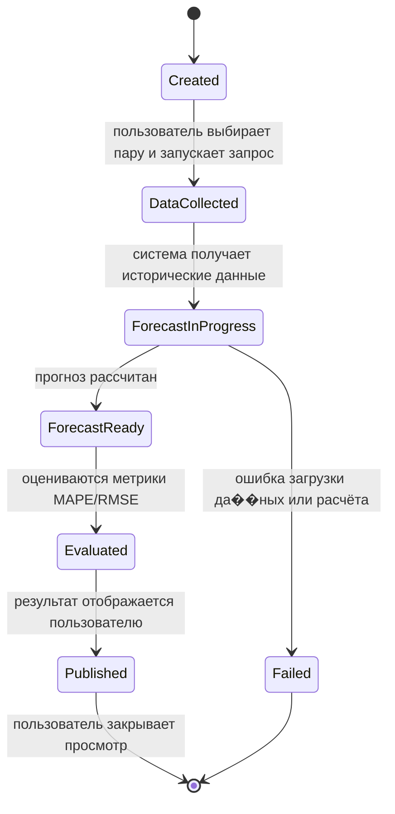

# Диаграмма состояний сущности "Прогноз валютной пары"

В качестве сущности с жизненным циклом выбраны результаты прогнозирования курса для конкретной валютной пары.

## Описание состояний

- Created — запрос на прогноз создан.
- DataCollected — загружены исторические данные курса для выбранной пары.
- ForecastInProgress — выполняется расчёт прогноза.
- ForecastReady — модель рассчитала значения прогноза.
- Evaluated — рассчитаны показатели качества прогноза.
- Published — результат показан пользователю.
- Failed — расчёт прервался из-за ошибки данных/модели.

## События и условия переходов

- пользователь выбирает валютную пару и запускает прогноз -> Created -> DataCollected;
- исторические данные успешно загружены -> DataCollected -> ForecastInProgress;
- прогноз успешно рассчитан -> ForecastInProgress -> ForecastReady;
- модель и метрики корректно рассчитаны -> ForecastReady -> Evaluated;
- результат отправлен в интерфейс -> Evaluated -> Published;
- ошибка на этапе загрузки данных или расчёта -> ForecastInProgress -> Failed;
- пользователь закрывает страницу/перестает смотреть результат -> Published -> [*];
- ошибка исправляется позднее или запрос не завершён -> Failed -> [*].
